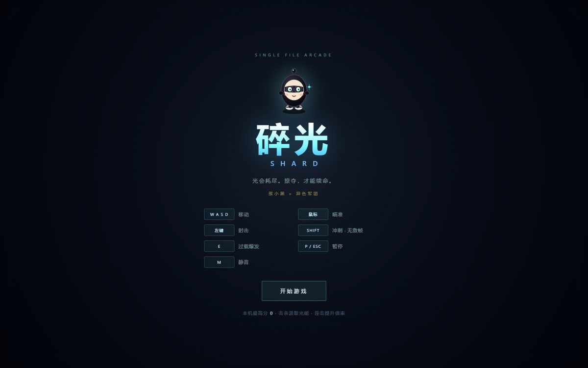
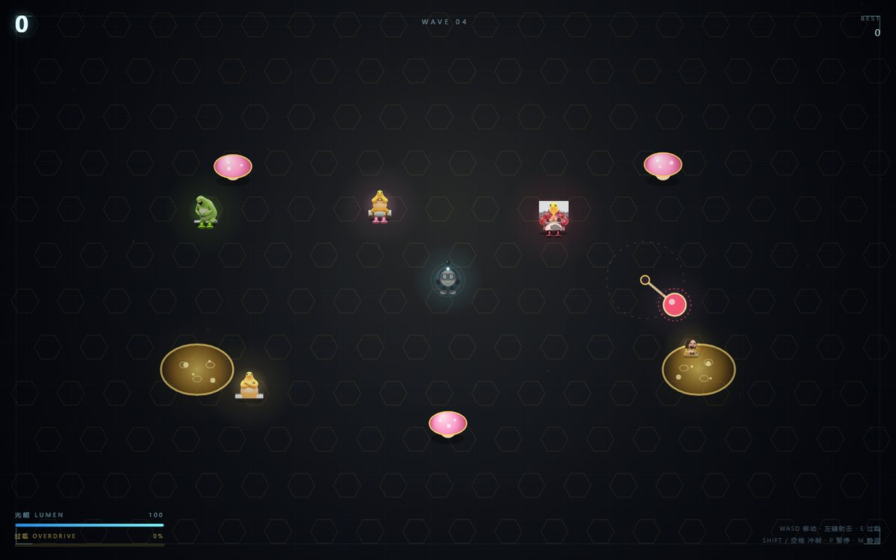

# 碎光 · SHARD

**一个单文件、开箱即玩的俯视角街机射击小游戏。**
你是黑蛋「蛋小黑」，在异色军团与暗光巨人的围攻里，抢回最后一点光。

光能既是生命值，也是续命资源——只有不断击杀，才能活下去。每清一波还能三选一构筑自己的 Build。




## 在线试玩

打开下面这个地址就能玩（手机、电脑都行）：

```text
https://<你的用户名>.github.io/shard-game/
```

- iOS Safari：分享 → **添加到主屏幕**
- Android Chrome：菜单 → **添加到主屏幕 / 安装应用**

加进主屏后会像原生小游戏一样全屏启动，没有地址栏。

## 玩法

| 操作 | 桌面 | 手机 |
| --- | --- | --- |
| 移动 | `WASD` / 方向键 | 左半屏虚拟摇杆 |
| 瞄准 | 鼠标 | 右半屏虚拟摇杆（带自动瞄准辅助） |
| 射击 | 按住左键 / `J` | 右半屏按住即自动射击 |
| 冲刺（有无敌帧） | `Shift` / `空格` / 右键 | 右下冲刺键 / 双击左半屏 |
| 过载 | `E` | 右下过载键 |
| 选卡 | `1` `2` `3` 或点击 | 点击卡牌 |
| 暂停 / 静音 | `P` `Esc` / `M` | 切出页面自动暂停 |

节奏：波次预警 → 敌人从边缘传送入场 → 走位射击 → 清空波次 → 偶数波三选一词条、第 6/12 波武器进化 → 每 6 波首领战。

新手一局 2–4 分钟，熟练后 6–12 分钟。

## 技术说明

- **纯静态**：只有一个 `index.html`，HTML / CSS / JS / 图片 / 音效全部内嵌，没有任何外部请求，断网也能玩。
- **无依赖**：不用 Node、不用打包、不用后端，双击文件就能跑。
- **触屏与键鼠双适配**：同一份代码自动识别设备并切换操作方案。
- 存档（最高分、图鉴解锁）走 `localStorage`。

## 本地运行

直接双击 `index.html` 即可（Chrome / Edge / Safari）。

想在手机上玩同一份：在项目目录执行

```bash
python -m http.server 8000
```

电脑和手机连同一个 Wi-Fi，手机访问 `http://电脑局域网IP:8000/`（Windows 用 `ipconfig` 查 IPv4）。

## 版权说明

本项目的美术与音效为**同人致敬性质**的二次创作，角色形象与语音版权归原权利人所有，**仅限个人学习与技术交流，不作商业用途**。

如果你是版权方并希望下架相关内容，请提 issue 联系，会立即处理。

## License

代码部分采用 MIT License。美术、角色、语音素材不在此授权范围内。
